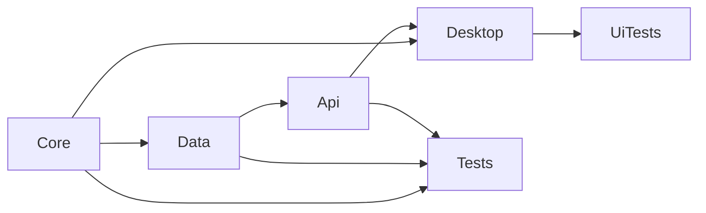
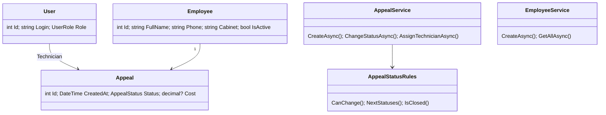

# Работа 2. Модульная структура проекта

## Модули

| Модуль | Ответственность | Зависимости |
|---|---|---|
| CollegeSupport.Core | Сущности, правила, DTO, интерфейсы, сервисы, обмен, безопасность, журнал | — |
| CollegeSupport.Data | EF Core, SQLite, миграции, репозитории | Core |
| CollegeSupport.Api | REST API, JWT, обработка ошибок, журнал, health | Core, Data |
| CollegeSupport.Desktop | WPF-клиент, ApiClient, диалоги | Core |
| CollegeSupport.Tests | Модульные и интеграционные тесты | Core, Data, Api |
| CollegeSupport.UiTests | UI-тесты FlaUI | Desktop |

## Диаграмма модулей (Mermaid)

## Диаграмма классов (Mermaid)

## Интерфейсы между модулями

| Интерфейс | Модуль | Реализация |
|---|---|---|
| IAppealRepository | Core | Data/Repositories/AppealRepository |
| IEmployeeRepository | Core | Data/Repositories/EmployeeRepository |
| IUserRepository | Core | Data/Repositories/UserRepository |
| IPasswordHasher | Core | Core/Security/Pbkdf2PasswordHasher |
| IAppLogger | Core | Core/Logging/FileAppLogger |
| ITokenService | Api | Api/Infrastructure/JwtTokenService |

## Обработка исключений (работа 11)

| Исключение | Где возникает | HTTP | Что видит пользователь | Уровень журнала |
|---|---|---|---|---|
| Ошибка валидации DTO | [ApiController] | 400 | Словарь ошибок по полям | — |
| BusinessRuleException | Сервисы Core | 400 | Текст правила | Warning |
| AuthenticationFailedException | AuthService | 401 | «Неверный логин или пароль» | Warning |
| NotFoundException | Сервисы Core | 404 | «Объект … не найден» | Warning |
| ConflictException / DbUpdateException | Core / EF Core | 409 | Общее сообщение о конфликте | Warning |
| Любое другое | Где угодно | 500 | «Обратитесь к администратору» | Error со стеком |
