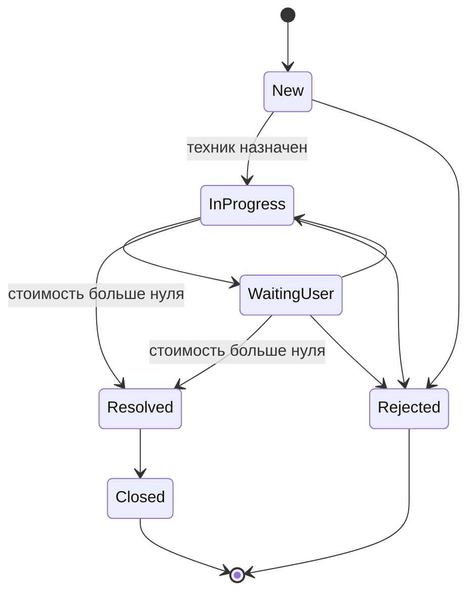

# Работа 1. Анализ предметной области и требования

Предметная область: техническая поддержка колледжа. Диспетчер регистрирует обращения сотрудников, назначает техника, техник решает обращение, администратор управляет пользователями и выгрузками.

## Роли

| Роль | Ответственность |
|---|---|
| Администратор | Пользователи, все операции с обращениями и справочником, обмен данными |
| Диспетчер | Регистрация обращений и сотрудников, назначение техника, смена статуса, обмен данными |
| Техник | Просмотр назначенных обращений, смена статуса только своих обращений |

## Жизненный цикл обращения

`Новое → В работе → Ожидает пользователя → Решено → Закрыто`; `Отклонено` — конечный статус, доступный из нескольких шагов.

Условия переходов (согласованы по образцу методички):
1. `В работе` — только с назначенным техником.
2. `Решено` — только со стоимостью работ больше 0.
3. `Ожидает пользователя` — только при непустом описании проблемы (проверяется при создании).

## Функциональные требования (12)

| № | Требование |
|---|---|
| ФТ-01 | Регистрация обращения с сотрудником, кабинетом, оборудованием и описанием |
| ФТ-02 | Просмотр списка обращений с фильтром по статусу и поиском |
| ФТ-03 | Просмотр карточки обращения по идентификатору |
| ФТ-04 | Смена статуса по таблице переходов |
| ФТ-05 | Назначение техника на обращение |
| ФТ-06 | Регистрация сотрудника справочника с нормализацией телефона |
| ФТ-07 | Техник меняет статус только своих обращений |
| ФТ-08 | Проверка логина и пароля, выдача JWT |
| ФТ-09 | Статистика: всего, открыто, завершено, сумма, средняя стоимость, средний срок |
| ФТ-10 | Импорт сотрудников из CSV с отчётом об ошибках по строкам |
| ФТ-11 | Выгрузка обращений в CSV, JSON, XML |
| ФТ-12 | Разграничение прав по ролям на уровне API |

## Нефункциональные требования (6)

| № | Требование |
|---|---|
| НФ-01 | .NET 10, одна версия для всех проектов |
| НФ-02 | WPF-клиент не содержит бизнес-правил |
| НФ-03 | Все запросы к серверу асинхронные, таймаут 15 с |
| НФ-04 | Даты в UTC, деньги в decimal, файлы обмена в InvariantCulture |
| НФ-05 | Пароли хранятся как соль + PBKDF2 (100 000 итераций) |
| НФ-06 | Все интерактивные элементы WPF имеют AutomationId |

## Пользовательские истории (5)

1. Диспетчер создаёт обращение и видит его в списке.
2. Диспетчер назначает техника и переводит обращение «В работе».
3. Техник видит только назначенные ему обращения и меняет статус.
4. Администратор импортирует сотрудников из CSV и получает отчёт об ошибках.
5. Администратор выгружает обращения в CSV и открывает файл в Excel.

## Жизненный цикл обращения

`New` — «Новое», `InProgress` — «В работе», `WaitingUser` — «Ожидает пользователя», `Resolved` — «Решено», `Closed` — «Закрыто», `Rejected` — «Отклонено».
